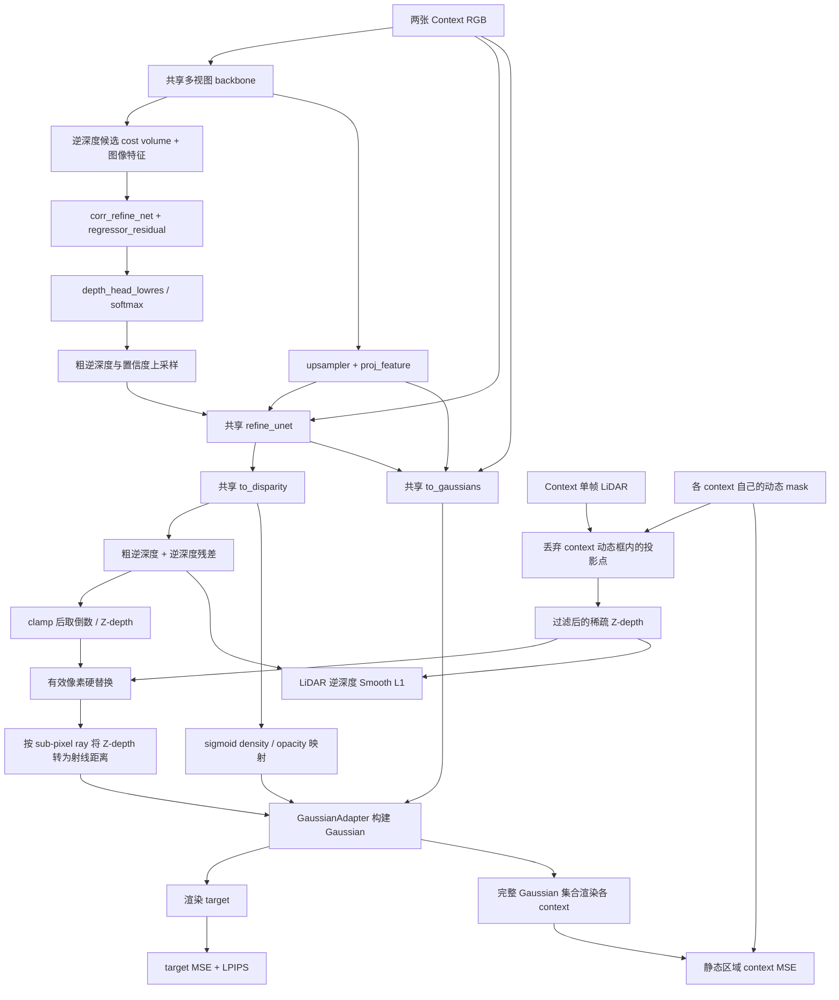

# LiDAR-Enhanced MVSplat

本项目基于 [MVSplat](https://github.com/donydchen/mvsplat)，将稀疏 LiDAR 用于 nuScenes 时序输入的深度监督与 Gaussian 中心深度锚定。当前 main 使用 **full_shared** 实现：两路 context 共享完整视觉网络和预测头，全参数微调。

本文介绍当前实现、数据要求和训练评测用法。

> **环境配置**：请查阅 [MVSplat 官方 GitHub 的 Installation 说明](https://github.com/donydchen/mvsplat#installation)。本项目不提供环境搭建步骤，安装过程以原仓库说明为准。

## 1. 当前入口与默认设置

nuScenes 的训练与测试入口是 `config/experiment/full_shared.yaml`，使用共享网络和预测头。仓库另保留 acid、dtu 配置。

| 项目 | full_shared 当前设置 |
| --- | --- |
| 数据 | nuScenes `v1.0-mini` |
| 相机 | 六路相机分别生成样本，共同训练 |
| 输入 / 目标 | 同一相机 `[t-1, t+1] → t` |
| 图像分辨率 | 176 × 320 |
| 深度范围 | camera Z-depth 1～80 m |
| 深度候选 / 每像素 Gaussian | 128 / 1 |
| 可训练参数 | `frozen_params: []`，不显式冻结 encoder 参数 |
| 初始化 | `checkpoints/re10k.ckpt`，只加载模型权重 |
| batch size | train=2，val/test=1 |
| 步数 / 初始配置学习率 | 60000 / `1e-4` |
| 优化器 / 调度器 | Adam / OneCycleLR，余弦退火 |
| checkpoint | 每2000个训练step保存，`save_top_k: -1` |
| 在线验证 / W&B | 默认关闭 / disabled |
| LiDAR 硬替换 | 训练、测试均开启 |

六路数据共同训练不等于六相机联合融合；一个样本只使用同一相机的两个时序 context。

## 2. 模型与损失

### 2.1 前向流程



`to_disparity` 是单个共享的 `Conv2d → GELU → Conv2d`，输出逆深度残差与 density；没有按 context 拆成独立头。`to_gaussians` 预测 sub-pixel offset、scale、rotation 和 SH 等原始属性，两路 context 共同使用。当前没有交替训练或旧拆头 checkpoint 自动迁移逻辑。

`GaussianAdapter` 是从网络输出构建 Gaussian 参数的转换模块，不是额外的 LiDAR cross-attention 属性修正网络。两路 context 的 Gaussian 合并后用于 target 和 context 渲染。

### 2.2 LiDAR 硬替换

`dataset.load_lidar_depth=true` 时，数据集使用 nuScenes SDK 将各 context 对应的单帧 `LIDAR_TOP` 投影到相机，再映射到裁剪图像；同像素多点保留最近 Z-depth，缺失处为0，不做稠密补全。使用相机和 LiDAR 各自拍摄时刻的标定与 ego pose。原始点云仍需读取并投影，但落在各 context 自己的动态框内的点在写入深度图前丢弃，对应像素保持0；训练与测试均执行过滤。

硬替换位于视觉逆深度 refinement、clamp 和取倒数之后，Gaussian 构建之前。只替换有限、正数且位于 near/far 范围内的点。替换像素不通过中心深度向视觉深度分支回传梯度，其他像素保留原梯度。

```yaml
model:
  encoder:
    use_lidar_bias_train: true
    use_lidar_bias_test: true
```

训练模式使用 train 开关；验证、测试的 eval 模式使用 test 开关。它们不影响下面的 LiDAR 逆深度监督是否启用。

### 2.3 当前总损失

full_shared 的实际目标为：

```text
L = L_target_MSE + 0.05 L_target_LPIPS
  + 1.0 L_LiDAR_inverse_depth + 1.0 L_context_RGB
```

- **target MSE**：整张 target 图像的均方误差，当前没有应用动态 mask。
- **target LPIPS**：VGG LPIPS，输入 normalize，整图计算，从 step 0 起启用。
- **LiDAR inverse depth**：在有效 context LiDAR 像素上，比较截断和硬替换之前的 `粗逆深度 + 残差` 与 `1 / LiDAR Z-depth`，使用 `beta=0.01` 的 Smooth L1，按有效元素数归一化。数据端已将动态框内的点过滤为0，因此不参与此 loss；loss 内无需再次读取 mask。无有效点时为0，有效原始预测保留梯度。
- **context RGB**：把两路 Gaussian 的完整合并集合分别渲染回两个 context 相机，在各自 `dynamic_mask < 0.5` 的静态区域计算 MSE；不是仅渲染该 context 自己的 Gaussian。

当前没有 gradient loss 或 `cross_visual_depth` loss。注册的 loss 包括 mse、lpips、depth、lidar_inverse_depth 和 context_rgb；full_shared 不启用 depth loss。

### 2.4 动态 mask 的实际用途

数据集根据带动态 attribute 的 annotation 3D box 投影二维矩形，并扩张：

```yaml
dataset:
  dynamic_mask_expansion_ratio: 0.15
  dynamic_mask_min_padding_px: 8
  dynamic_mask_min_depth: 0.01
```

仅生成各 context 自己时刻的 mask，动态属性为 `vehicle.moving`、`pedestrian.moving`、`cycle.with_rider`。3D 框投影成二维矩形，每侧扩展对应宽/高的15%，至少8像素。**target mask 已删除**，不再生成跨时刻投影并集，也不写入 target batch。

| 环节 | 动态区域处理 |
| --- | --- |
| 输入 RGB、特征与 cost volume | 保留完整图像 |
| context RGB loss | 排除各自动态框内的误差，按静态有效元素数归一化 |
| LiDAR 深度图 | 写入前丢弃动态框内的投影点，位置记0 |
| LiDAR inverse-depth loss / 硬替换 | 自动跳过0值；框内不受 LiDAR 监督或替换 |
| target MSE、LPIPS 与测试指标 | 全图计算，动态区域参与 |

动态区域的 Gaussian 没有被删除，仍参与合并和渲染；若影响框外像素，仍可能通过重建误差获得梯度。

`dataset.load_lidar_depth=false` 只关闭点云读取与投影，当前仍根据 annotation 生成 context mask，供 context RGB loss 使用。未启用 context RGB loss 且关闭 LiDAR 加载时，生成的 mask 不参与训练目标。启用 LiDAR 时，其过滤仍依赖 context 动态标注。

## 3. 数据准备

```text
datasets/nuscenes/
├── maps/
├── samples/
├── sweeps/                 # 按下载包提供；当前深度使用单帧点云
├── v1.0-mini/
└── v1.0-trainval/          # 扩大数据时准备
checkpoints/
└── re10k.ckpt
```

RE10K 预训练权重从 [MVSplat 官方仓库](https://github.com/donydchen/mvsplat)获取。full_shared 设置 `unimatch_weights_path: null`，通过完整 RE10K checkpoint 初始化；构造 backbone 时打印的 from scratch 不代表随后没有加载完整权重。若改为从头训练，则需要自行决定是否提供 backbone 初始化。

## 4. nuScenes 采样与划分

当前数据集只支持 `num_context_views=2`、`num_target_views=1`，`frame_stride` 为正数。在每个 scene 的 sample 链上构建 `[t-stride,t+stride] → t`，不调用通用 view_sampler 选择时序窗口。改用 `dataset/view_sampler=evaluation` 不会将 nuScenes 变成 RE10K evaluation index 协议。

| 数据版本 | train | val | mode=test |
| --- | --- | --- | --- |
| v1.0-mini | mini_train | mini_val | mini_val |
| 非 mini（当前代码分支） | 官方 train | 官方 val | 官方 test |

`dataset.version=v1.0-trainval` 可用于完整数据训练。当前 `mode=test` 选择官方 test 场景，不会自动评测官方 val；在 trainval 元数据下可能为空，且当前动态 mask 依赖 annotation。因此完整数据的本地离线评测需先修正 split 映射：官方 train 场景训练，本地 `mode=test` 使用官方 val 场景。数据划分应按完整 scene 进行，避免相邻时序窗口跨集合重叠。

默认 `num_workers=0`。nuScenes 实现为 IterableDataset，当前迭代器未按 worker/rank 分片；不要未经验证就增加 worker 或用多 GPU 正式报告结果，以免重复迭代样本。

只使用前视相机：

```text
dataset.camera_names=null dataset.camera_name=CAM_FRONT
```

## 5. 训练、恢复与配置检查

### 5.1 full_shared 微调

```bash
python -m src.main +experiment=full_shared mode=train \
  checkpointing.load=checkpoints/re10k.ckpt \
  checkpointing.resume=false \
  wandb.name=full_shared \
  hydra.run.dir=outputs/full_shared/train
```

默认60000步；通过 `trainer.max_steps` 覆盖总训练步数。

```bash
# 只检查 Hydra 合成配置，不启动训练
python -m src.main +experiment=full_shared --cfg job
```

当前 `wandb.name` 默认是历史遗留的 baseline，不能根据此名称判断是否关闭 LiDAR。建议显式覆盖运行名称；W&B 默认 disabled，启用时自行设置 project、entity 和 mode。

### 5.2 调度与在线验证

`cosine_lr=true` 实际构造 `OneCycleLR(total_steps=max_steps+10, pct_start=0.01, cycle_momentum=False, anneal_strategy='cos')`，并非手写 warmup+cosine；此路径不使用配置里的 `warm_up_steps=500`。设为 false 才使用对应 warm_up_steps 的 LinearLR。

调度曲线取决于总步数；60000步调度中的第40000步不等于40000总步数调度的最后一步。

默认 `train.run_validation=false`，不执行在线验证和 sanity validation。需要时设置 `train.run_validation=true`；当前 val dataloader 使用 ValidationWrapper 的单样本封装，不能把在线验证当作完整验证集评测。训练保留 loss 和 checkpoint，正式指标通过离线评测获得。

## 6. 离线测试

### 6.1 测试已训练 full_shared（mini）

```bash
python -m src.main +experiment=full_shared mode=test \
  checkpointing.load=/absolute/path/to/full_shared.ckpt \
  wandb.name=full_shared_test \
  test.compute_scores=true \
  test.output_path=outputs/evaluation \
  hydra.run.dir=outputs/full_shared/test
```

full_shared 默认开启测试时的 LiDAR 硬替换。关闭时设置 `model.encoder.use_lidar_bias_test=false dataset.load_lidar_depth=false`。测试不执行训练 loss，因此可以保留 LiDAR loss 配置并关闭点云加载。

测试 batch size 必须为1。测试入口通过 Lightning 加载 checkpoint；`checkpointing.resume` 的训练恢复开关不用于改变测试的权重来源。

### 6.2 RE10K 纯视觉直接推理

使用 full_shared 关闭 LiDAR，从 RE10K 预训练权重直接推理：

```bash
python -m src.main +experiment=full_shared mode=test \
  checkpointing.load=checkpoints/re10k.ckpt \
  model.encoder.use_lidar_bias_train=false \
  model.encoder.use_lidar_bias_test=false \
  dataset.load_lidar_depth=false \
  '~loss.lidar_inverse_depth' '~loss.context_rgb' '~loss.lpips' \
  wandb.name=re10k_visual \
  test.output_path=outputs/evaluation \
  hydra.run.dir=outputs/re10k_visual/test
```

测试不计算训练 loss；上面的 loss 覆盖也避免实例化不需要的训练项。

### 6.3 输出与指标口径

测试写入 `test.output_path / wandb.name`，与 Hydra run dir 不同：

```text
outputs/evaluation/full_shared_test/
├── <scene_camera_window>/color/<target_index>.png
├── scores_psnr_all.json
├── scores_ssim_all.json
├── scores_lpips_all.json
├── scores_all_avg.json
├── benchmark.json
└── peak_memory.json
```

PSNR/SSIM 越高越好，LPIPS 越低越好，均为整图指标。逐批分数JSON当前是数值列表，没有显式样本ID。`eval_time_skip_steps=5` 仅排除前几个 batch 的计时，不排除其图像质量分数。计时为编码器/解码器调用，不等于含数据读取和 LiDAR 投影的完整系统延迟。当前 benchmark 使用 CPU wall clock 包围 GPU 调用，没有显式 CUDA 同步；准确模型计时与端到端计时需要补充实现，不能直接把现有数值作为准确 GPU 时长。关闭 compute_scores 时也会输出 benchmark 和峰值显存，但不会应用质量评测分支中的计时跳过逻辑。

当前测试不输出 LiDAR loss、AbsRel 或 RMSE；训练日志中的 `loss/lidar_inverse_depth` 不等于独立深度评测。独立深度指标应评估硬替换前的网络预测，尽量使用未参与输入/监督的点，避免把硬替换后锚点的零误差当作学习收益。

测试默认保存图片；大规模评测可设 `test.save_image=false`。空数据不构成有效结果，开始前核对 split 与非零样本数。

## 7. 配置与工具兼容性

当前保留的历史文件有以下限制：

- `config/model/encoder/costvolume.yaml` 中的 `use_lidar_gaussian_adapter`、`lidar_gaussian_edit_*` 等旧字段不在当前 EncoderCostVolumeCfg 中，也没有对应的属性修正前向路径，不能通过开启字段启用历史 adapter。
- `test.save_lidar_alpha_diagnostics` 和 `train.enable_depth_losses` 等遗留 YAML 字段没有当前对应执行逻辑，不应据此宣称功能已启用。
- `src/scripts/measure_context_alignment.py` 使用硬编码的历史图片目录与关键点，是一次性诊断脚本。
- `wo_cost_volume_refine` 当前有实际执行分支，并非其他分支文档所说的 no-op；修改该架构开关可能改变 checkpoint 结构，需单独验证。

## 8. 代码目录

```text
config/experiment/full_shared.yaml     # full_shared 训练与测试入口
config/dataset/nuscenes.yaml            # nuScenes 基础配置
src/dataset/dataset_nuscenes.py         # 时序窗口、投影、动态 mask
src/model/encoder/encoder_costvolume.py # 共享编码器与 LiDAR 硬替换
src/model/encoder/costvolume/           # cost volume / 深度 refinement
src/model/model_wrapper.py             # 训练、评测、优化器
src/loss/                              # 损失实现
tests/                                 # 几何、硬替换、逆深度监督检查
```

环境配置请直接查阅 [MVSplat 官方 GitHub 的 Installation 说明](https://github.com/donydchen/mvsplat#installation)。本项目不提供环境搭建步骤，安装过程以原仓库说明为准；预训练资源也请参照官方仓库。

## 9. 致谢与引用

本项目基于 [MVSplat](https://github.com/donydchen/mvsplat) 开发，原项目安装与预训练资源以其官方说明为准。

```bibtex
@article{chen2024mvsplat,
  title   = {MVSplat: Efficient 3D Gaussian Splatting from Sparse Multi-View Images},
  author  = {Chen, Yuedong and Xu, Haofei and Zheng, Chuanxia and Zhuang, Bohan and Pollefeys, Marc and Geiger, Andreas and Cham, Tat-Jen and Cai, Jianfei},
  journal = {arXiv preprint arXiv:2403.14627},
  year    = {2024}
}
```

## 10. 版权声明

Copyright © 2026 张雪丽. All rights reserved.

未经著作权人书面许可，不得复制、修改、发布、再许可或用于商业及学术成果申报。
